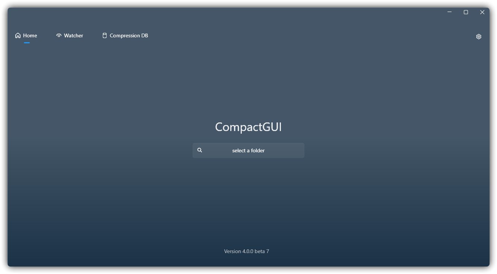
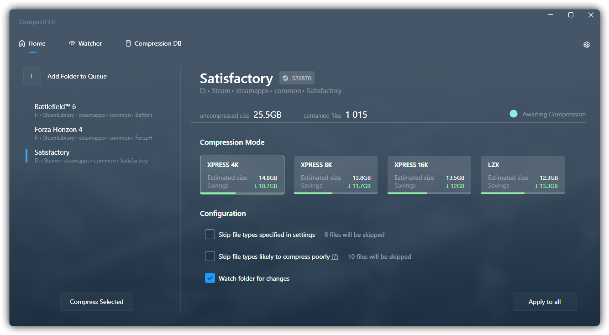
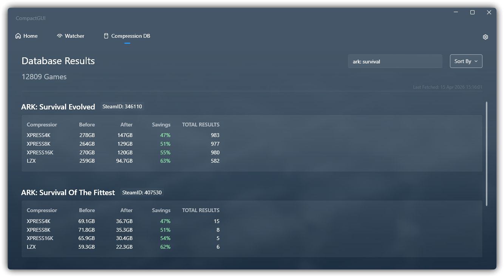
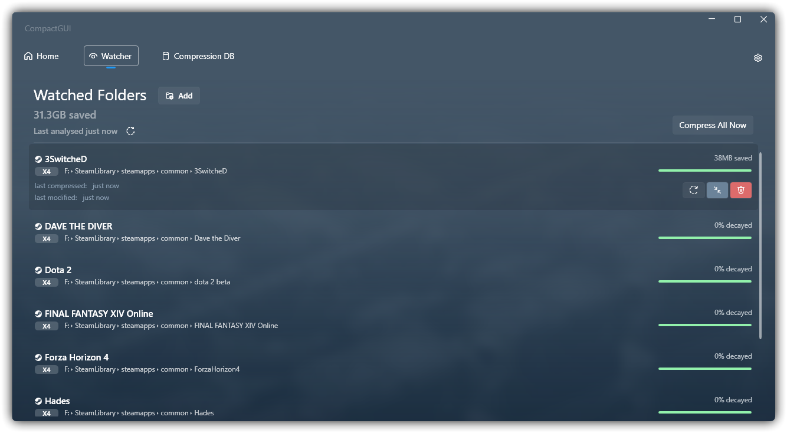

<p align="center"></p>

<p align="center">
  <a href="https://github.com/IridiumIO/CompactGUI/releases">
    </a>&nbsp;&nbsp;&nbsp;&nbsp;
  
  <a href="https://github.com/IridiumIO/CompactGUI/releases">
    </a>
  </br> 
</p>


<p align="center"><b>CompactGUI は、ゲームやプログラムの機能を損なうことなく、使用容量を削減するために透過的な圧縮を行います。本ツールは Win32 API を直接的に利用することで、Windows 10 以降の環境で利用可能な標準のコマンドラインツール <code>compact.exe</code> と同等の機能を実現。</b></p>

&nbsp;
&nbsp;

<p align="center"></p>
<p align="center">



</p>

---


<p align="center">
  <a href="../README.md">English</a> -
  <a href="README_ru.md">Русский</a> -
  <a href="README_cn.md">简体中文</a> -  
  <a href="README_it.md">Italian</a> -
  <a href="README_id.md">Bahasa Indonesia</a>
 - 日本語
</p>
&nbsp;

---


&nbsp;

**仕組み**:

CompactGUI は、Windows 10 で初めて導入された高機能な圧縮機能、具体的には Windows Overlay Filter (WOF) ドライバーが提供するファイルシステム圧縮アルゴリズムを使いやすく利用できるようにするツールです。本ツールを使用すると、ファイルやフォルダー (特にゲーム関連) を透過的に圧縮でき、パフォーマンスを低下させることなく、ディスク容量を大幅に節約することが可能になります。

**透過的？ それはどういう意味ですか？**

透過的圧縮とは、ファイルが zip や rar 形式のように再パッケージ化されることなく、何事もなかったかのようにコンピューター上でそのまま利用可能にする仕組みのことです。以前と全く同じようにファイルの閲覧やゲームプログラムの起動が可能でありながら、使用するディスク容量は少なく済みます。

**これは以前のバージョンの Windows に組み込まれている圧縮機能とどう違うのですか？**

Windows に従来から組み込まれている圧縮機能 (右クリック > プロパティ > ディスク領域を節約するために内容を圧縮する) と似ていますが、Windows 10 以降で導入された新しいアルゴリズムは、はるかに優秀でパフォーマンスへの影響もほとんど与えずに、より高い圧縮率を実現しています。詳細は[こちら](https://learn.microsoft.com/ja-jp/windows/win32/cmpapi/using-the-compression-api)をご覧ください。

<h2>インストール  </h> 
   
####


または Winget でインストール:

```py
winget install CompactGUI
```

## 使用

このツールを使用するとフォルダーを圧縮しても通常通りの使用や実行が可能です:

- ゲームのサイズを削減 (例 ARK-Survival Evolved: 169 GB > 91.2 GB)
- プログラムのサイズを削減 (例 Adobe Photoshop: 1.71 GB > 886 MB)
- コンピューター上の他のフォルダーを圧縮

## 追加機能

- 圧縮の進捗と統計に関する視覚的なフィードバック
- スキップ対象とする圧縮効率の悪いファイル形式のリスト
- 圧縮率の推定機能 - コミュニティから寄せられた 10 万件以上のデータ (実際にはそれ以上の数がありましたが、Google フォームの件数の上限に気づかなかったため多くの回答が消失しました) を基に多数の Steam ゲームに関する正確なデータを算出
  - Steam 以外のゲーム以外でもアルゴリズムによる推定を利用で、圧縮のしやすさの目安をある程度把握することができます。
  - 貢献にご協力いただける場合は Steam ゲームの実行結果を CompactGUI 内からオンラインデータベースに送信することができます。
- 使いやすさの向上のために Windows エクスプローラーのコンテキストメニューに統合
- 既存のフォルダーの状態を解析
- バックグラウンドの監視 - 指定したフォルダーを監視して変更 (Steam ゲームのアップデートなど) を検知し、バックグランドで自動的に圧縮の状態を維持

<h4 align="center"><b>10 万件を超える投稿 <a href="https://github.com/ImminentFate/CompactGUI/wiki/Community-Compression-Results"> </a>の中からテスト済みのものについては <a href="https://github.com/ImminentFate/CompactGUI/wiki/Community-Compression-Results">Wiki</a> をご確認ください。</b></h3>
<p>&nbsp;</p>

## 警告

**Windows 11 で DirectStorage を使用するゲームには、このツールを使用しないでください。**

DirectStorage は、CPU を介さずに SSD から直接的にゲームを読み込めるようにする新しい API です。圧縮されたファイルは CPU に送る前に展開する必要があり、性能向上のメリットが失われてしまうからです。

## バックグラウンド

Windows 10 にはあまり知名度がありませんが、非常に便利なツールの `compact.exe` が導入されました。これを使用することで、ディスク上のフォルダーやファイルを圧縮して実行時に展開することができます。近年の CPU であれば (2010 年製の i3-370M な古いモデルでも検証済みで影響は気にならない程度) この処理に伴う負荷はほとんど気になりません。特に容量の小さい SSD を使用している場合、ディスク容量を節約できる点で大きなメリットがあります。

プログラムフォルダーやゲームのサイズを最大 60% まで小さくできるため、特に低速な HDD を使用している場合には、読み込み時間を短縮できるメリットもあります。

Windows の組み込み機能に関する詳細情報は[こちら](https://learn.microsoft.com/ja-jp/previous-versions/windows/it-pro/windows-xp/bb490884(v=technet.10))と[こちら](https://learn.microsoft.com/ja-jp/windows/win32/cmpapi/using-the-compression-api)で確認するか、コマンドラインで `compact /q` と入力することで確認できます。

このツールは、意図的にフォルダーとファイルの圧縮のみを行うように設計されています。ドライブ全体や Windows のシステム全体を CompactGUI から変更することはできません。そのような機能が必要であれば、コマンドラインから `compact /compactOS` を実行してください。

この圧縮は完全に透過的で行われます。プログラム、ゲーム、ファイルはこれまで通りにアクセスでき、エクスプローラー上での表示も変わることはありません。ディスク上では圧縮されたまま保持され、実行時のみ RAM 上で展開される仕組みになっています。

## 圧縮モード

既定では、`XPRESS8K` のアルゴリズムを使用して圧縮を実行します。これにより、圧縮速度と圧縮率のバランスが最適化されます。一方、Windows の既定は `XPRESS4K` であり、こちらは処理速度は高速ですが、圧縮率は低くなります。

任意の圧縮モード:

| アルゴリズム | 主な利点                  | 詳細説明                                                                                                |
| :-------- | :------------------------------- | :------------------------------------------------------------------------------------------------------------------ |
| XPRESS4K  | 最高速だが、圧縮率は低い             | 極めて高い読み込み速度が求められるゲームファイルに適しており、圧縮しつつもパフォーマンスを最大限に引き出すことができます。 |
| XPRESS8K  | 速度と圧縮率のバランスが良い | 圧縮速度と圧縮率のバランスが良好です。                                 |
| XPRESS16K | 低速だが、圧縮率が高い             | ストレージの容量が限られており、読み込み速度への要求が低めのシナリオに適しています。                               |
| LZX       | 最低速だが、圧縮率が強力           | アーカイブファイル、バックアップデータまたは頻繁にアクセスされないコールドデータの保存に適しています。                     |

---

### このプロジェクトがお気に召しましたか？

Ko-Fi でチップを送っていただければ幸いです :)

 <p align="center"><a href='https://ko-fi.com/iridiumio' target='_blank'></a></p>

